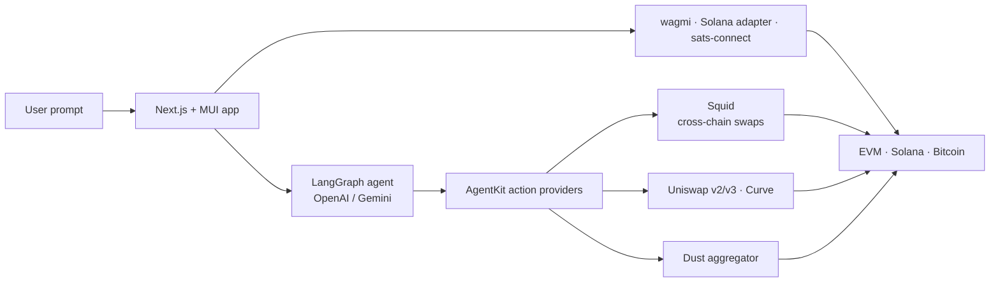

# Agentic_AI

### Multi-chain AI DeFi agent: swaps, bridging, liquidity, and dust clean-up by chat

     

A chat-driven DeFi app. A LangGraph agent with Coinbase AgentKit action providers turns prompts into on-chain actions across EVM chains, Solana, and Bitcoin:

- Token transfers and swaps, plus **cross-chain bridging** through Squid
- **Liquidity** on Uniswap v2/v3 and Curve
- A **dust aggregator** that sweeps small balances into one token
- Wallets via wagmi, Solana wallet adapter, and sats-connect; state in Zustand



---

## Development

This is a [Next.js](https://nextjs.org/) project bootstrapped with [`create-next-app`](https://github.com/vercel/next.js/tree/canary/packages/create-next-app).

## Getting Started

First, run the development server:

```bash
npm run dev
# or
yarn dev
# or
pnpm dev
# or
bun dev
```

////

Open [http://localhost:3000](http://localhost:3000) with your browser to see the result.

You can start editing the page by modifying `app/page.tsx`. The page auto-updates as you edit the file.

This project uses [`next/font`](https://nextjs.org/docs/basic-features/font-optimization) to automatically optimize and load Inter, a custom Google Font.

## Learn More

To learn more about Next.js, take a look at the following resources:

- [Next.js Documentation](https://nextjs.org/docs) - learn about Next.js features and API.
- [Learn Next.js](https://nextjs.org/learn) - an interactive Next.js tutorial.

You can check out [the Next.js GitHub repository](https://github.com/vercel/next.js/) - your feedback and contributions are welcome!

## Deploy on Vercel

The easiest way to deploy your Next.js app is to use the [Vercel Platform](https://vercel.com/new?utm_medium=default-template&filter=next.js&utm_source=create-next-app&utm_campaign=create-next-app-readme) from the creators of Next.js.

Check out our [Next.js deployment documentation](https://nextjs.org/docs/deployment) for more details.
